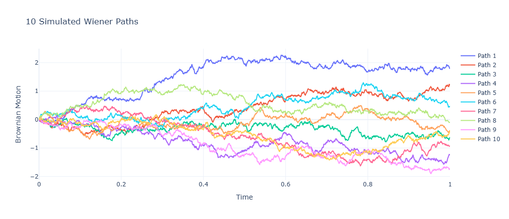
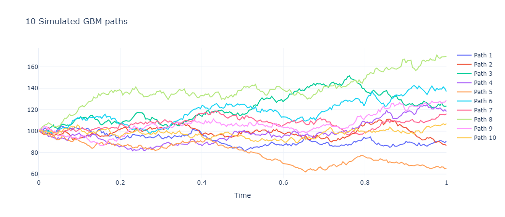

# Heston-Model-Stochastic-Volatility-Based-Option-Pricing

## Brownian Motion (Wiener Process)

Brownian motion is a continuous-time random process used to model accumulated random movement. In finance, it is often used as the random component of stock-price models such as geometric Brownian motion.

### Key properties

For standard Brownian motion (W_t):

- It starts at zero: (W_0 = 0).
- Its increments over non-overlapping time intervals are independent.
- Over an interval of length $(\Delta t\)$, an increment is normally distributed:

  $[
  W_{t+\Delta t}-W_t \sim N(0,\Delta t).
  \]$

This is simulated using a standard normal random variable $(Z\sim N(0,1)\)$:

$[
\Delta W = \sqrt{\Delta t}\,Z.
\]$

Adding the increments gives the path:

$[
W_{t_k}=\sum_{j=1}^{k}\Delta W_j,\qquad W_0=0.
\]$

### Figure: ten simulated paths

Each line is one possible realization, not a prediction. The paths share the same starting value of zero, while each subsequent increment is randomly drawn with variance equal to its time-step length.

## Geometric Brownian Motion (GBM)

Geometric Brownian motion is a continuous-time model for a quantity that changes proportionally to its current level. It is widely used as a simple model for stock prices because it produces positive prices while allowing random movement.

### Model

The GBM stochastic differential equation is

$[
dS_t = \mu S_t\,dt + \sigma S_t\,dW_t,
\]$

where:

- $(S_t\)$ is the price at time \(t\).
- $(\mu\)$ is the annualized drift parameter.
- $(\sigma\)$ is the annualized volatility.
- $(W_t\)$ is standard Brownian motion.

For a time step $(\Delta t\)$, the exact GBM update is

$[
S_{t+\Delta t}=S_t\exp\left[\left(\mu-\frac{1}{2}\sigma^2\right)\Delta t + \sigma\sqrt{\Delta t}\,Z\right],
\qquad Z\sim N(0,1).
\]$

The $(-\frac{1}{2}\sigma^2\)$ term appears because the simulation updates the logarithm of price. The exponential update keeps simulated prices positive.

Each line is one simulated scenario under the stated assumptions. These paths illustrate the model’s possible outcomes; they are not forecasts of an actual asset price.

## Black–Scholes model

The Black–Scholes model is a mathematical method for estimating the theoretical price of a European call or put option. It takes the current underlying price, strike price, time remaining, risk-free interest rate, volatility, and dividend yield as inputs. In simple terms, it estimates the value today of the possible option payoff at expiration, accounting for uncertainty and the time value of money.

The model assumes a particular pattern of price uncertainty and is a pricing framework, not a guarantee of the market price or a prediction of where the underlying will go. This project calculates call and put values and plots how they change as the underlying price or time to expiration changes.

## Parameters

| Parameter | Meaning |
|---|---|
| `S` | Current price of the underlying asset |
| `K` | Option strike (exercise) price |
| `T` | Time to expiration, measured in years |
| `r` | Annualized risk-free interest rate, as a decimal |
| `sigma` | Annualized volatility, as a decimal |
| `q` | Annualized continuous dividend yield, as a decimal; defaults to 0 |

For example, `sigma=0.20` represents 20% annualized volatility, and `T=0.5` represents six months to expiry.

## Formulas

$[
d_1=\frac{\ln(S/K)+(r-q+\frac{1}{2}\sigma^2)T}{\sigma\sqrt{T}},
\qquad
d_2=d_1-\sigma\sqrt{T}.
\]$

Using \(N(x)\) for the standard normal cumulative distribution function:

$[
C=S e^{-qT}N(d_1)-K e^{-rT}N(d_2),
\]$

$[
P=K e^{-rT}N(-d_2)-S e^{-qT}N(-d_1).
\]$

