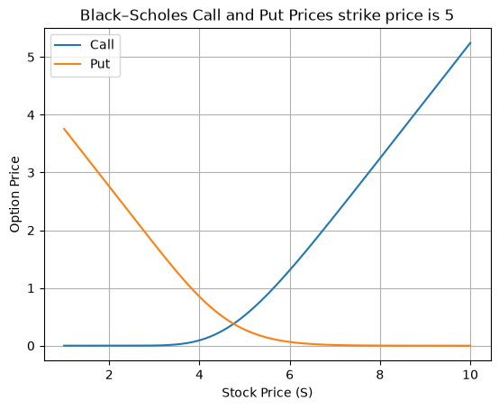
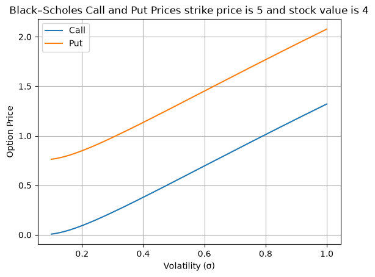
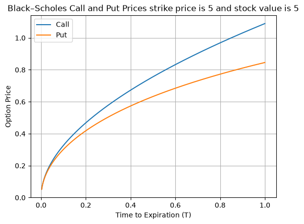

## Black–Scholes model

The Black–Scholes model is a mathematical method for estimating the theoretical price of a European call or put option. It takes the current underlying price, strike price, time remaining, risk-free interest rate, volatility, and dividend yield as inputs. In simple terms, it estimates the value today of the possible option payoff at expiration, accounting for uncertainty and the time value of money.

The model assumes a particular pattern of price uncertainty and is a pricing framework, not a guarantee of the market price or a prediction of where the underlying will go. This project calculates call and put values and plots how they change as the underlying price or time to expiration changes.

## Parameters

| Parameter | Meaning |
|---|---|
| `S` | Current price of the underlying asset |
| `K` | Option strike (exercise) price |
| `T` | Time to expiration, measured in years |
| `r` | Annualized risk-free interest rate, as a decimal |
| `sigma` | Annualized volatility, as a decimal |
| `q` | Annualized continuous dividend yield, as a decimal; defaults to 0 |

For example, `sigma=0.20` represents 20% annualized volatility, and `T=0.5` represents six months to expiry.

## Formulas

$[
d_1=\frac{\ln(S/K)+(r-q+\frac{1}{2}\sigma^2)T}{\sigma\sqrt{T}},
\qquad
d_2=d_1-\sigma\sqrt{T}.
\]$

Using $(N(x)\)$ for the standard normal cumulative distribution function:

$[
C=S e^{-qT}N(d_1)-K e^{-rT}N(d_2),
\]$

$[
P=K e^{-rT}N(-d_2)-S e^{-qT}N(-d_1).
\]$

### Option Premium relationships
| Test | Result |
|---|---|
| Call price as `S` increases | Increases |
| Put price as `S` increases | Decreases |
| Call price as volatility `sigma` increases | Increases |
| Put price as volatility `sigma` increases | Increases |
| Option time value as expiration approaches | Decreases toward zero; at expiry, only intrinsic payoff remains |
| Put–call parity | Holds: $(C-P=S e^{-qT}-K e^{-rT}\)$ |

### Figures

