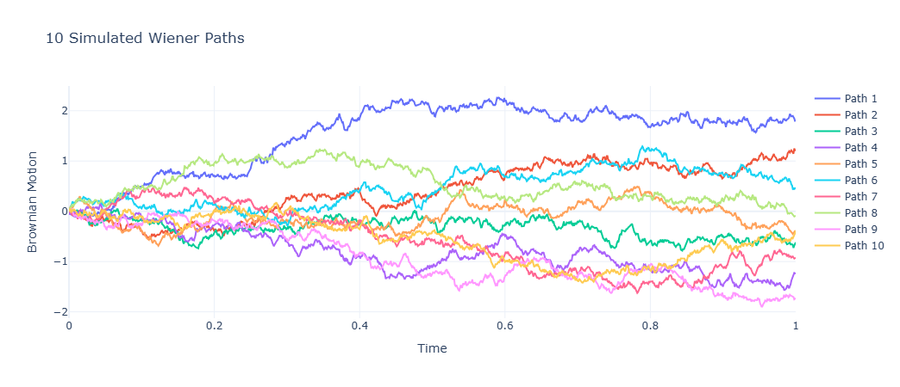

## Brownian Motion (Wiener Process)

Brownian motion is a continuous-time random process used to model accumulated random movement. In finance, it is often used as the random component of stock-price models such as geometric Brownian motion.

### Key properties

For standard Brownian motion (W_t):

- It starts at zero: (W_0 = 0).
- Its increments over non-overlapping time intervals are independent.
- Over an interval of length $(\Delta t\)$, an increment is normally distributed:

  $[
  W_{t+\Delta t}-W_t \sim N(0,\Delta t).
  \]$

This is simulated using a standard normal random variable $(Z\sim N(0,1)\)$:

$[
\Delta W = \sqrt{\Delta t}\,Z.
\]$

Adding the increments gives the path:

$[
W_{t_k}=\sum_{j=1}^{k}\Delta W_j,\qquad W_0=0.
\]$

### Figure: ten simulated paths

Each line is one possible realization, not a prediction. The paths share the same starting value of zero, while each subsequent increment is randomly drawn with variance equal to its time-step length.
